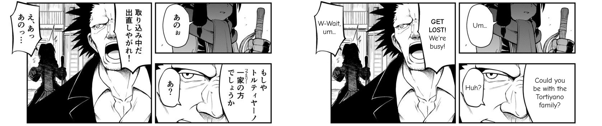
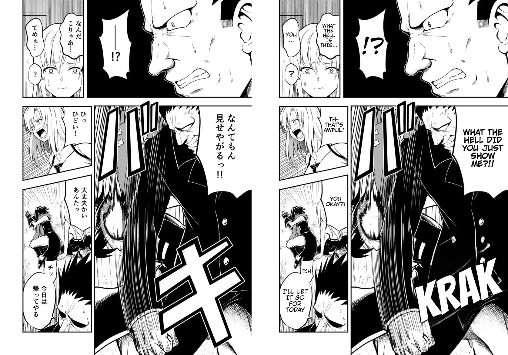
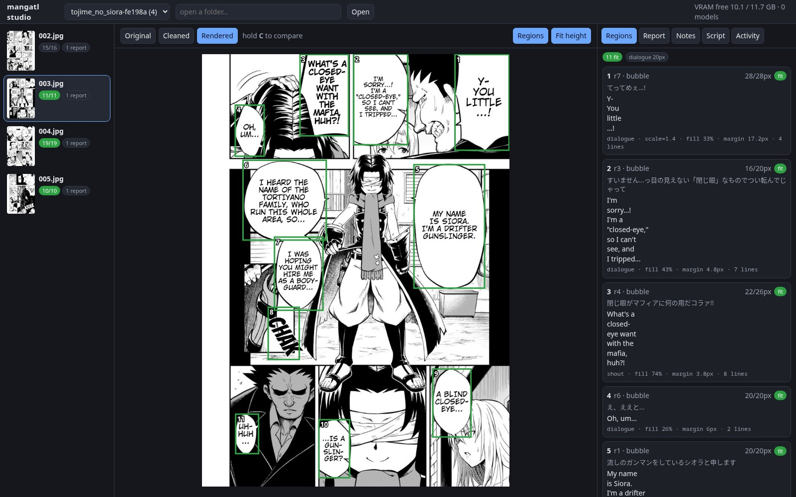

# mangatl studio: agent-based manga translation

An Agent-based translation and lettering pipeline for manga pages, emulating the way scanlation teams work.
A local server runs the studio work where the standard pipeline tools live: text detection, cleaning, reading and typesetting.
These tools are exposed as an MCP server the agent can connect to. The agent (Claude Code, Codex, any MCP client) 
works as the translator, letterer and editor. 
It reads the chapter(s), keeps a glossary of terms and character notes,
hands pages to sub-agents, writes the target language, figures out the lettering per speech bubble, 
reviews the rendered page and can send weak pages back for more rounds.

This is an early MVP version, and as such guzzles tokens like crazy right now. Improvements pending on that regard.

```bash
uv run python studio.py                                                  # UI: http://127.0.0.1:7870
claude mcp add --transport http mangatl-studio http://127.0.0.1:7870/mcp  # once, in Claude Code
```

Then, in Claude Code: `/mcp__mangatl-studio__translate_folder /path/to/chapter`, or simply
*"translate the manga in /path/to/chapter with the studio"*.

## Examples

Japanese original on the left. On the right, the studio's output, with every line translated and
lettered by Claude Code through the MCP tools. The coordinator wrote the chapter notes first
(characters, terms, lettering conventions), then ran one sub-agent per page. No human edits.

**Dialogue.** Siora is polite and flustered and the thug is crude, as the chapter notes said.
閉じ眼 ("closed-eye", the series' word for a blind person) is kept as the fixed term the notes
chose. The agent's lettering choices:
- the yelled line uses the `shout` preset;
- the thug's "Y-you little...!" is at 1.4× size;
- the sound effect is rotated 60° into its own box on the art;
- each line is broken to suit the shape of its bubble.



**Action.**
- KRAK is lettered white with a black outline, at 158 px, tilted 20° counter-clockwise across
  the panel.
- The "!?" is scaled up to fill its jagged bubble.
- The shaken lines are set slightly smaller.
- The outburst uses `shout`.



Pages from the [OpenMantra dataset](https://github.com/mantra-inc/open-mantra-dataset) (Hinami et
al., AAAI 2021; CC BY-NC 4.0): *Tojime no Siora*, `eval/in/tojime_no_siora/`.

## How it works

```
 the agent (MCP client)               the studio (local GPU server)
 ──────────────────────               ─────────────────────────────
 coordinator
   open_project, draft     ──►        detect bubbles, text on the art, panels,
                                      reading order; erase the text; OCR;
                                      size the lettering per page
   get_script, set_glossary,
   update_notes, set_style_sheet
 worker (one per page)
   claim_page, get_page    ◄──        regions: OCR text, panel, size cap
   annotate_regions,
   set_translations,       ──►        re-render; per region: fit / too small /
   set_style, preview_region          doesn't fit, size, fill, margin, lines
   view_page, view_region  ◄──        the rendered page or a region, as an image
   release_page (report)
 coordinator
   review_page, check_consistency
   export_project          ──►        script.md, .cbz, what's still unresolved
```

No language model runs in the studio. Everything that needs judgment is left to the agent:
translation, voice, names, which lettering a bubble calls for, whether a detection is really text,
and whether a page reads well. The studio does what models do reliably (detection, inpainting, OCR)
and reports exact measurements back, so the agent never has to guess whether its text fits.

The workflow the agent follows is in [`mangatl/studio/playbook.md`](mangatl/studio/playbook.md).
The server gives it to the agent (`get_playbook`, and the `translate_folder` prompt):
1. The **coordinator** drafts the chapter and reads all of it as a script.
2. It writes the glossary, character notes (speaker names, how each character talks, honorific and
   SFX policy) and lettering conventions.
3. It hands out pages to **workers**, one sub-agent per page.
4. It reviews each page and requests changes where needed.
5. It runs a consistency pass and exports.

## The tools

| Area | Tools |
|---|---|
| Project | `get_playbook`, `open_project`, `list_projects`, `draft`, `project_status` |
| Reading | `get_page` (regions with outcomes, problems, hints, reviews), `view_page`, `view_region` (layers, zoom), `get_script` (whole chapter or one speaker), `get_context` (neighbouring pages), `region_history` |
| Translating | `set_translations` (with speakers and styles), `annotate_regions` (speaker, corrected source, dismiss a false detection, link the bubbles of one sentence), `set_order` |
| Lettering | `set_style`, `preview_region` (up to four variants side by side, nothing saved), `get_style_sheet`, `set_style_sheet`, `list_fonts` |
| Chapter | `get_glossary`, `set_glossary`, `check_consistency` (glossary misses, name variants, honorifics, lines without a speaker), `get_notes`, `update_notes` |
| Workflow | `claim_page`, `release_page` (worker report), `review_page` (approve / request changes), `export_project` (script, CBZ) |

**Lettering.** Each project has a style sheet of presets. By default:

| Preset | Lettering |
|---|---|
| `dialogue` | CC Wild Words, capitals |
| `shout` | bold, 1.3× size |
| `thought` | italic |
| `whisper` | 0.85× size |
| `narration` | Anime Ace |

Text on the art gets the automatic lettering (Bangers for sound effects), unless the sheet
defines an `outside` preset (the example run's coordinator added one: Bangers, black with a white
outline). Any region can override its preset with font, size or scale, capitals, bold or italic,
alignment, line spacing, rotation, colour, outline, a text box or offset, and padding.
Inline `*italic*` and `**bold**` work for single words, and `--` is drawn as an em dash. Styles are
saved in the page document and survive re-rendering.

## Inspector UI



`http://127.0.0.1:7870` shows the work as it happens:
- each page's progress, state (drafted, in progress, translated, changes requested, approved),
  problems, claims and reports;
- the original, cleaned and rendered layers (hold `C` to compare), with regions outlined and
  coloured by outcome;
- each region's source, translation, preset, size, fill and margin;
- tabs for the worker reports and reviews, the chapter notes and glossary, the script, and a log of
  every tool call.

Projects live in `studio_data/<folder>-<hash>/`:
- `project.mtl`: SQLite, holding the page documents and the full edit history;
- `out/`: the rendered pages;
- `notes.md`, `script.md`, `activity.jsonl`.

## What the studio runs (all local)

| Stage | Models |
|---|---|
| Detection | YOLOv8 manga109 bubble segmentation, RT-DETR conjoined-bubble detector, manga109 panel YOLO (reading order), AnimeText YOLO + comic-text-detector for text on the art |
| OCR | Hayai OCR v2.5 Nova (line by line for text blocks on the art), cross-checked with manga-ocr in bubbles |
| Cleaning | flat fill in bubbles, Koharu SAM-TS-L glyph masks, LaMa-manga inpainting |
| Typesetting | Skia / HarfBuzz: fitting to the bubble, hyphenation, per-page size matching, real and synthetic bold and italic, ♥ ♪ ★ from a symbol font |

Models stay loaded in one long-lived engine, which unloads idle ones when VRAM runs short
(`--set runtime.vram_budget_mb=N` caps it). Interactive requests (an agent re-rendering a page) go
ahead of drafting.

## Setup

- An NVIDIA GPU (developed on an RTX 4070 Ti, 12 GB), [uv](https://docs.astral.sh/uv/), Python 3.13.
- Models download on first use; `--offline` refuses to download.
- **Fonts.** The default style sheet uses CC Wild Words and Anime Ace. Their licences forbid
  redistribution, so add them yourself as `fonts/CC Wild Words/` and `fonts/Anime Ace/`, with
  -Regular, -Bold and -Italic in the file names. Alternatively, have the agent switch the sheet to
  the bundled Comic Neue and Bangers (SIL OFL) with `set_style_sheet`.
- **Text on the art** (narration, signs) needs the gated
  [`deepghs/AnimeText_yolo`](https://huggingface.co/deepghs/AnimeText_yolo) model. Accept its terms
  with the Hugging Face account whose token is in `~/.cache/huggingface/token`, or set `HF_TOKEN`.
  Without it, only bubbles are drafted.
- The studio binds to 127.0.0.1. Options: `--port`, `--workspace`, `--set PATH=VALUE` (settings
  for drafts).

## Status

This is a research prototype that improves one run at a time. Each run puts a fresh Claude Code
instance on a chapter, and its output and its own feedback on the tools become the next issue.
Done so far:
- the MCP server and the inspector;
- per-region lettering with measurements and previews;
- chapter bookkeeping: speakers, glossary, script, reviews, history, export.

Not yet possible:
- adding, splitting or merging regions the detector got wrong;
- re-cleaning a region;
- curved text;
- editing in the UI.

The agent reports these as it meets them.

**Old pipeline.** `translate.py` and `webui.py` are the earlier fully local batch translator
(Gemma 4 via llama.cpp, with a web reader). They still run but are being removed (#32), along with
the code that only served them.

## Development

```bash
uv run ruff check . && uv run ruff format --check .
uv run --group dev pyright
uv run python -m pytest -q --ignore=tests/test_engine_gpu.py --ignore=tests/test_stages_gpu.py --ignore=tests/test_studio_gpu.py
uv run python -m pytest -q tests/test_studio_gpu.py tests/test_stages_gpu.py   # GPU: a full MCP session end to end
```

CI runs ruff, pyright and the light tests on CPU. Changes to detection, cleaning or typesetting are
checked against saved reference output (`eval/`, see `eval/README.md`), which must show zero
differences unless a change is meant to alter output.

## Layout

```
studio.py             entry point: MCP server + inspector UI
mangatl/studio/       workspace.py (projects, drafts, renders with outcomes, claims, reviews,
                      glossary, script, export), tools.py (MCP tools), web.py + static/ (UI),
                      playbook.md (the agent's workflow)
mangatl/pipeline/     stages.py (detect, clean, prepare, ocr, typeset, render), stored.py (stages
                      on a stored page)
mangatl/engine/       models (local-first download), VRAM budget, priority GPU slot, jobs
mangatl/project/      page document, operation log with undo, the SQLite project file
mangatl/typeset/      layout, fonts, renderer, style.py (per-region lettering)
mangatl/detect/, ocr/, clean/, ml/
fonts/                Comic Neue, Bangers (OFL); add licensed fonts as fonts/<Name>/
eval/                 benchmark pages (OpenMantra) and the regression harness
tests/
```

## Credits

The image pipeline in `mangatl/` is derived from
[MangaTranslator](https://github.com/meangrinch/MangaTranslator) (Apache-2.0; see `mangatl/NOTICE`).
Model licences: Hayai OCR Apache-2.0; comic-text-detector weights GPL-3.0. Symbol font: DejaVu Sans
(`assets/symbols/LICENSE-DejaVu.txt`).
